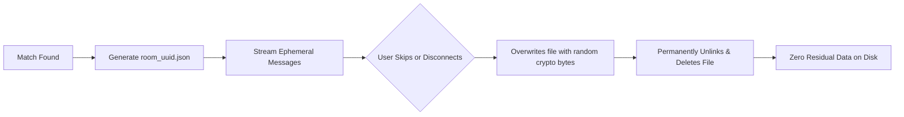

# 🇵🇭 Filmeet

> **Connect, Chat, and Play — Filipino Random Video Discovery & Squad Lobbies with Ephemeral Data Auto-Shredding.**  
> Built **100% with Free and Open-Source Software (FOSS)**. Zero paid APIs, zero subscriptions.

---

## 🌟 Overview

**Filmeet** (*Filipino Meets*) is a spontaneous video discovery and party chat platform designed to connect people through genuine face-to-face conversations and casual multiplayer mini-games:

1. **Two Matchmaking Modes**: Connect 1-on-1 or assemble a random **Squad of 4** in a shared 4-peer video room.
2. **Strict Ephemeral Privacy (Zero Permanent Logs)**: Room chats and event history are stored only in temporary session JSON files. When any user skips or leaves, the server **cryptographically shreds the session file** with random noise before deleting it from disk.
3. **Interactive Mini-Games Suite**: Play **Chess**, **Snake Battle**, and **Tetris** directly in the room without leaving the video call.
4. **Anti-Spam Game Challenge System**: Players cannot unilaterally force or spam game changes; game requests require confirmation via an unobtrusive top-right prompt.
5. **Adaptive Layouts**:
   - **Desktop**: Live cameras flank the left and right sides of the game arena so videos are never blocked and no screen space is wasted.
   - **Mobile**: Dual cameras sit at the top in a compact row, with the responsive game arena vertically centered below, and the chat drawer cleanly hidden until opened.

---

## 🎮 Interactive Mini-Games Suite

| Game | Modes | Gameplay Highlights | Controls |
| :--- | :--- | :--- | :--- |
| ♟️ **Live Chess Showdown** | 1v1 Pair (or 2 players + spectators in Squad) | Full chess rules engine via `chess.js`. Legal moves, check indicator, checkmate/draw alerts, dynamic perspective (Black automatically faces Black), and 1-click **Rematch (Swap Sides)**. | Click piece $\rightarrow$ Click destination square. |
| 🐍 **Multiplayer Snake Battle** | 2 to 4 Players | Real-time arena survival. Color-coded snakes matching player video tiles. Eat food, grow, avoid walls and other snakes. Round-end trophy celebration. | **PC**: Arrow keys / `W, A, S, D`<br>**Mobile**: On-screen touch D-Pad. |
| 🧱 **Tetris Battle** | 2 to 4 Players | **Multiplayer Attacks**: Clearing 2+ lines sends penalty garbage rows to opponents! Pre-game voting for target score (500 pts, 1,000 pts, 2,500 pts, or Survival Mode). Live dual-board streaming in 1v1. | **PC**: Arrow keys + Space bar to hard drop.<br>**Mobile**: On-screen Rotate, Drop, and direction buttons. |
| 💣 **Word Bomb Showdown** | 2 to 4 Players | **Fast-Paced Word Combat**: Ticking bomb with syllable prompt (e.g. `[ MA ]`, `[ TER ]`). 3 lives per player. Type valid words before timer explodes! Supported by 17,000+ English & Tagalog words. | **Keyboard/Mobile**: Type word containing prompt and press Enter / "Defuse". |

---

## 🛡️ Ephemeral Shredder & Privacy Architecture



* **Session Creation**: Each active room creates `server/sessions/room_<uuid>.json`.
* **Shredding Protocol**: When someone clicks **SKIP / NEXT** or leaves:
  1. The server overwrites the file with random cryptographic noise (`crypto.randomBytes`).
  2. The file is unlinked (`fs.unlinkSync`).
  3. In-memory maps are wiped.
  4. Both clients reset their chat window to a clean slate.

---

## 📐 Responsive UI Design

### Desktop Layout (In-Game)
Cameras flank the left and right of the board, using empty space and keeping the center game arena completely unblocked:
```
+---------------------------------------------------------------------------------+
|                                 Header Bar                                      |
+---------------------------------------------------------------------------------+
|                                                                                 |
|  +--------------+               +----------------------+      +--------------+  |
|  |  Player 1    |               |                      |      |  Player 2    |  |
|  |  Camera      |               |     GAME ARENA       |      |  Camera      |  |
|  |  (Left side) |               |  (Chess/Snake/Tetris)|      |  (Right side)|  |
|  |              |               |                      |      |              |  |
|  +--------------+               |   Centered & Fixed   |      +--------------+  |
|  | Score / Info |               |   No vertical cutoffs|      | Score / Info |  |
|  +--------------+               +----------------------+      +--------------+  |
|                                                                                 |
+---------------------------------------------------------------------------------+
|                                 Controls Bar                                    |
+---------------------------------------------------------------------------------+
```

### Mobile Layout (In-Game)
Both cameras sit in a compact top bar with the game centered below, and chat hidden by default:
```
+---------------------------------------------------+
|                   Header Bar                      |
+---------------------------------------------------+
|  +---------------------+  +--------------------+  |
|  | Player 1 Camera     |  | Player 2 Camera    |  |
|  | (Top Left, compact) |  | (Top Right,compact)|  |
|  +---------------------+  +--------------------+  |
|                                                   |
|             +-------------------------+           |
|             |       GAME ARENA        |           |
|             |   (Centered below)      |           |
|             +-------------------------+           |
|                                                   |
+---------------------------------------------------+
|                   Controls Bar                    |
+---------------------------------------------------+
```

---

## 🛠️ Tech Stack (100% Free & Open-Source)

* **Frontend**: React 18, Vite, Tailwind CSS, Lucide React, HTML5 Canvas.
* **Backend**: Node.js, Express, Socket.io, `uuid`, `crypto`.
* **Media & RTC**: Browser-native WebRTC Mesh with **Google Free Public STUN servers** (`stun:stun.l.google.com:19302`).
* **Game Engines**:
  * `chess.js` (FOSS chess rules and validation)
  * Custom Canvas 2–4 Player Snake Engine
  * Custom Multiplayer Tetris Engine with garbage-line attack routing

---

## 🚀 Getting Started

### Prerequisites
* [Node.js](https://nodejs.org/) (v18 or higher)
* [ngrok](https://ngrok.com/) (Optional, for mobile local network testing)

### Installation
Clone the repository and install dependencies:
```bash
# Install backend dependencies
cd server
npm install
cd ..

# Install frontend dependencies
cd client
npm install
cd ..
```

### 1-Click Launchers (Windows)
* **`run-server.bat`**: Starts the backend server on `http://localhost:5000` (serves the pre-compiled frontend).
* **`run-ngrok.bat`**: Starts an ngrok tunnel forwarding to port 5000 for mobile testing.

### Manual Terminal Commands

#### 1. Build the Frontend
```bash
cd client
npm run build
cd ..
```

#### 2. Start the Server
```bash
node server/index.js
```
The application will be live at `http://localhost:5000`.

---

## ☁️ Deploying to Render

When deploying as a **Web Service** on [Render](https://render.com/):

| Setting | Value |
| :--- | :--- |
| **Language** | `Node` |
| **Build Command** | `npm run build` |
| **Start Command** | `node server/index.js` |

Render provides an automatic free `https://` SSL certificate so WebRTC camera and mic permissions work natively on all devices.

---

## 📁 Project Structure

```
Testing 1/
├── .gitignore                   # Ignores node_modules, sessions, dist, logs
├── package.json                 # Root script definitions
├── README.md                    # Project documentation
├── run-server.bat               # 1-click Windows server launcher
├── run-ngrok.bat                # 1-click Windows ngrok launcher
│
├── server/                      # Backend Node.js / Express / Socket.io
│   ├── index.js                 # Server entrypoint & socket dispatch
│   ├── matchmaker.js            # 1v1 and Squad matchmaking queues
│   ├── sessionStore.js          # Ephemeral JSON file manager & secure shredder
│   ├── sessions/                # Ephemeral session folder (auto-cleaned)
│   └── games/
│       ├── ChessMatch.js        # 2-player Chess + Spectators
│       ├── SnakeBattle.js       # 2-4 Player Snake Arena
│       └── TetrisBattle.js      # 2-4 Player Battle Tetris with voting
│
└── client/                      # Frontend Vite + React + Tailwind CSS
    ├── index.html               # SPA Entry
    ├── vite.config.js           # Vite configuration & proxy settings
    ├── tailwind.config.js       # Custom colors & styling
    └── src/
        ├── App.jsx              # Main stage, layout manager & game invite state
        ├── hooks/
        │   ├── useSocket.js     # Real-time WebSocket connection
        │   └── useWebRTC.js     # Multi-peer mesh WebRTC manager
        └── components/
            ├── LobbySelection.jsx # Mode selection (1v1 vs Squad)
            ├── VideoGrid.jsx    # Multi-camera grid
            ├── VideoTile.jsx    # Compact video tile (camera, mic, name)
            ├── ChatBox.jsx      # Ephemeral chat feed with self-destruct indicator
            ├── Controls.jsx     # Mic, cam, game hub, skip controls
            ├── GameSelectorModal.jsx # In-call game launcher dialog
            └── games/
                ├── ChessGameView.jsx  # Interactive chessboard
                ├── SnakeGameView.jsx  # Snake canvas with mobile D-Pad
                └── TetrisGameView.jsx # Dual-board Tetris battle view
```

---

## 📄 License
This project is open-source under the **MIT License**.
